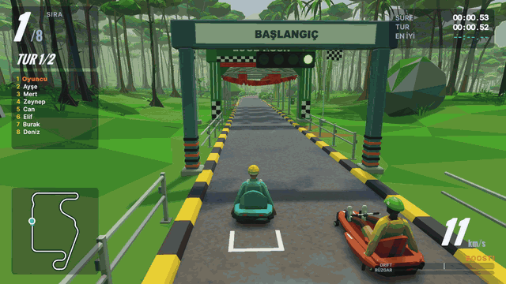

# Luge Rush

Low-poly, arcade hissiyatlı 3D **kızak (luge) yarışı**. Yerçekimiyle yokuş aşağı, drift ve rüzgar çekme ile hızlan; botlara karşı tek başına ya da oda kurup arkadaşlarınla yarış.

**[19 saniyelik videoyu izle (1080p, 60 fps, MP4)](Docs/Media/luge-rush-trailer.mp4)**

Görüntüler oyunun Windows build'inden otomatik sürücüyle kaydedildi. Videoda oyunun yarış müziği çalar; oyun içi efekt sesleri yoktur.

## Ekran görüntüleri

| | |
|---|---|
|  |  |
| **Yeşil Vadi:** tropik orman | **Çam Zirvesi:** alp dağı |
|  |  |
| **Kızıl Kanyon:** çöl kanyonu | **Birinci şahıs kamera** |
|  |  |
| **Kızak seçimi** | **Sonuç ekranı** |

## Özellikler

- **3 harita:** Yeşil Vadi, Çam Zirvesi ve Kızıl Kanyon; her biri kapalı devre ve kablolu lift ile tamamlanır.
- **4 kızak tipi:** Orman (dengeli), Ok (viraj), İkiz (düzlük) ve Fıstık (çeviklik).
- **Yarış mekanikleri:** Yerçekimiyle hızlanma, drift boostu, rüzgar çekme, başlangıç itişi ve takılınca reset.
- **Tek oyuncu:** 0–7 bot, 3 zorluk seviyesi ve 1–10 tur seçimi.
- **Çok oyunculu:** En fazla 8 kızaklık oda; boş yerler botla doldurulabilir.
- **Kamera:** 1. ve 3. şahıs görünüm, lift ve bitiş kameraları.
- **Ses:** Python ile sentezlenmiş 24 ses, müzik ve efekt karışımı.

## Teknik

- **Motor:** Unity 6000.3.19f1 (URP); proje `Game/` klasöründe
- **Sanat:** Blender 5.2, betikle üretilen low-poly modeller ve animasyonlar; `Art/`
- **Ağ:** Netcode for GameObjects, doğrudan IP ve Unity Relay/Lobby (oda kodu)
- **Seviyeler:** Tohumlu prosedürel arazi ve GPU instancing ile çevre yerleşimi
- **Test:** Unity Test Framework ile EditMode ve PlayMode testleri, player üzerinde otomatik yarış ve menü akışı

## Durum

Oyun tek oyunculu olarak baştan sona oynanabilir. Çok oyunculu yarış doğrudan IP ile iki kopya üzerinde test edildi. Relay/Lobby için Unity Cloud bağlantısı henüz yapılmadı. Geliştirme devam ediyor.

Belgeler: [GDD](Docs/GDD.md) · [Mimari](Docs/ARCHITECTURE.md) · [Sanat Rehberi](Docs/ART_GUIDE.md)

> Bu repo Git LFS kullanır: `git lfs install` sonra klonla.
